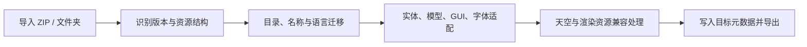

<div align="center">
  
  <h1>Fast Pack</h1>
  <p><strong>让材质包跟上你的 Minecraft 版本。</strong></p>
  <p>纯 Rust · 多版本自动适配 · 本地处理 · 免费非商业使用</p>

  <a href="https://github.com/LongCold-ColdEternity-Team/Fast-Pack/releases/latest"></a>
  <a href="LICENSE"></a>
  <a href="https://github.com/LongCold-ColdEternity-Team/Fast-Pack/stargazers"></a>
</div>

Fast Pack 是面向 Minecraft Java Edition 的材质包版本转换工具，由 **ColdEternity Team、Long_Cold、Wind_** 开发。导入 ZIP 或已解压的材质包，选择目标版本后，程序自动处理资源目录、纹理命名、实体 UV、模型与方块状态、GUI 图集、字体、天空以及材质包内的渲染资源兼容规则。

**原始仓库：[LongCold-ColdEternity-Team/Fast-Pack](https://github.com/LongCold-ColdEternity-Team/Fast-Pack)**  
**下载成品：[GitHub Releases](https://github.com/LongCold-ColdEternity-Team/Fast-Pack/releases/latest)**

## 项目特点

- **多版本自动适配。** 覆盖 1.8.9 至 26.2 的 29 个版本标签，支持升级、降级和同版本整理。目标版本的规则自动执行，常见布局无需玩家补文件、改路径或调整透明度。
- **按渲染代际处理资源。** 识别材质包中的核心与后处理着色器，优先匹配包内的目标版本变体；对已识别的引用规则进行处理，跨代且无可确认兼容变体的覆盖自动备份回退。程序会明确记录原效果未被保留的情况。
- **天空资源跨格式迁移。** 自动处理 MCPatcher、OptiFine 的目录与 `source` 引用，重排六面贴图朝向，并支持已识别的静态 FSB / Nuit 天空结构与反向转换。旧包转到新版本时，天空资源也参与转换。
- **实体贴图按像素重建。** 箱子 UV 重排、双箱左右拆分、旧船到新船的纹理映射、旗帜和盾牌透明掩码转换都由程序执行，支持标准布局的高清比例。
- **GUI 与字体一起迁移。** 根据 88 条精灵配方拆分或合并 GUI 图集，生成窄版效果列表，适配游戏模式槽位与附魔光效，处理旧 Unicode 字体页。
- **现代桌面体验。** 深色 / 浅色主题、拖放导入、后台识别与转换、真实进度、天空贴图预览，以及约 150–280ms 的界面过渡。支持减少动态效果。
- **保留输入原包。** 转换在临时工作副本中完成，结果另存。改写的资源会在输出包内保留原始备份，帮助后续转换恢复内容。
- **输出 ZIP 更干净。** v1.1.0 起不再向材质包内加入 `转换报告.txt`；输入包已有的同名根目录报告也会从新输出中移除。转换详情仍可在程序内查看或另存。
- **GUI、CLI 和 Rust 库共用转换逻辑。** 桌面玩家可以直接操作界面，开发者也可以批量调用命令行或集成转换库。

Fast Pack 的兼容规则负责转换渲染资源。自定义天空的显示取决于客户端已有的天空渲染能力；未知 GLSL 的自动回退使用目标游戏的默认渲染，原有着色器效果不会被保留。

## 下载与使用

1. 打开 [最新 Release](https://github.com/LongCold-ColdEternity-Team/Fast-Pack/releases/latest)，下载 `FastPack.exe`，或下载 Windows x64 便携包。
2. 双击 `FastPack.exe`，把材质包 ZIP 或文件夹拖入窗口。
3. 选择目标版本与输出位置，点击“开始转换”。资源适配默认自动执行。
4. 完成后，通过“打开输出目录”取得转换结果，再将材质包交给对应版本的游戏加载。

运行桌面版无需解释器或浏览器。材质包处理在本机完成，程序不会把上传内容发送到远端服务。“了解详细”中的源码按钮会在用户点击后打开 GitHub 页面。

右上角的 **“了解详细”** 展示开发者头像、版本、开发交流群、进群答案、源码仓库与许可证摘要。

### 转换过程中发生了什么



源包保持原样。输出包内的 `fastpack/` 保存转换所需的原始资源、天空缓存与兼容信息，这些文件帮助反向转换恢复内容。

## 自动适配能力

| 资源类型 | 自动处理内容 |
| --- | --- |
| 纹理目录与名称 | `blocks/items` 与 `block/item` 的目录迁移、已知名称映射、动画元数据同步改名与后续版本路径变化 |
| 语言资源 | 旧 `.lang` 与新 JSON 语言格式互转，保留可解析内容 |
| 箱子 | 1.15 UV 重排、双箱拆分为左右纹理、高清比例与反向合并 |
| 船与其他实体 | 旧船 UV 重建、船桨纹理生成、实体目录别名、26.x 矿车路径及旧船反向重建 |
| 旗帜 / 盾牌 | 将旧图案掩码转为 alpha，结合上传的底图 RGB；降级时生成旧式灰度掩码 |
| 末影龙 | 清理 1.15 删除的龙翼底面 UV，并保留原图 |
| 模型 / 方块状态 | 旧手持显示结构、生成物品父模型、普通状态键、已识别的颜色和木材分支、模型名称与引用、1.21.4+ 物品定义 |
| 游戏模式 GUI | 在实际 UV 的 `y=75` 行将两个 25px 槽位适配为 26px |
| 背包 GUI | 从原效果列表的边框生成窄版效果背景，保留材质风格 |
| GUI 图集 | 从 1.20.2 起按 88 条配方生成独立精灵，保留高清比例；支持反向合并 |
| 附魔光效 | 生成物品、实体与盔甲光效资源，同步动画元数据，支持旧版统一纹理 |
| Unicode 字体 | 将上传的 16×16 字符网格页转成 bitmap 提供器，补 uniform 定义及目标默认字形回退 |
| 天体 | 26.x 太阳路径与八张月相资源的拆分、旧式月相图合并 |
| 天空 | 路径与纹理引用重写、六面朝向、可表达的淡入淡出和条件迁移、静态天空格式转换、原始层缓存 |
| 材质包着色器 | 代际识别、目标版本变体匹配、已识别的 import 规则处理、跨代覆盖的自动备份与回退 |

## 支持的版本标签

| 系列 | 版本 |
| --- | --- |
| 1.8–1.12 | 1.8.9、1.9.4、1.10.2、1.11.2、1.12.2 |
| 1.13–1.16 | 1.13.2、1.14.4、1.15.2、1.16.1、1.16.5 |
| 1.17–1.19 | 1.17.1、1.18.2、1.19.2、1.19.3、1.19.4 |
| 1.20 | 1.20.1、1.20.2、1.20.4、1.20.6 |
| 1.21 | 1.21.1、1.21.3、1.21.4、1.21.5、1.21.6、1.21.8、1.21.10、1.21.11 |
| 26.x | 26.1.2、26.2 |

版本表内置于源码，26.2 使用资源格式 88。程序不会联网更新版本规则。相同 `pack_format` 的版本可能共用一组适配规则；表外版本标签当前不提供直接选择。

## 兼容范围

- 面向 **Minecraft Java Edition 材质包 / 资源包**；独立光影包与基岩版包不在处理范围内。
- 自定义天空依赖客户端本身具备相应渲染能力，资源包文件无法给纯原版客户端新增该能力。
- 跨代 GLSL 缺少可确认兼容变体时会回退默认渲染，转换后的包可失去原着色器特效。
- 任意动态天空关键帧、自定义模型谓词、已删除功能和新版本独有方块，无法保证在旧版本中等价表现。未识别内容会保留或注明处理结果。
- 冲突与未知名称会进入转换详情；原包仍会保留。
- 未在每个 Minecraft 版本、客户端加载器及实际材质包中逐一验证游戏画面。有限样例不代表任意资源都完全等价。
- Windows x64 桌面版是当前发布目标。库与 CLI 可用于其他平台，当前 Release 提供 Windows 构建。

## 命令行

便携包包含 `fast-pack-cli.exe`。以下命令默认执行自动适配：

```powershell
.\fast-pack-cli.exe old.zip new.zip --to 26.2
.\fast-pack-cli.exe modern.zip legacy.zip --from 26.2 --to 1.8.9
.\fast-pack-cli.exe old.zip output_folder --folder --to 1.20.1
.\fast-pack-cli.exe old.zip --probe
.\fast-pack-cli.exe --versions
.\fast-pack-cli.exe old.zip new.zip --to 26.2 --quiet
.\fast-pack-cli.exe old.zip new.zip --renames names.json --report-json report.json
```

`--from auto` 默认自动识别源版本。`--report-json` 仅在指定时将详情另存到提供的路径，不会把 `转换报告.txt` 塞入输出 ZIP。自定义映射采用 JSON 对象，例如 `{"custom_texture":"replacement_texture"}`。

GUI 对已有输出提供覆盖确认；CLI 会替换明确指定的已有输出。输出不得与源路径相同，也不得覆盖源目录或其上级目录。

## 从源码构建

推荐使用 Rust MSVC 稳定版工具链，以及包含 Windows SDK 的 Visual Studio C++ Build Tools。当前项目使用 Rust 2024 edition、Iced 0.14 和静态 CRT 配置；构建工具本身不随程序分发。

```powershell
git clone https://github.com/LongCold-ColdEternity-Team/Fast-Pack.git
cd Fast-Pack
cargo build --release --locked
```

构建结果：

```text
target-native/release/FastPack.exe
target-native/release/fast-pack-cli.exe
```

源码仓库保留 Rust 实现、Cargo 文件、构建配置、内置资源配方、图标、开发者头像和文档。编译产物在 Releases 分发。测试输入由 Rust 代码生成，仓库无需携带打包的测试 ZIP。

开发者可以按需执行：

```powershell
cargo fmt --all -- --check
cargo clippy --all-targets --locked -- -D warnings
cargo test --all-targets --locked
```

需要使用软件渲染时，可在启动前指定后端：

```powershell
$env:ICED_BACKEND = 'tiny-skia'
.\target-native\release\FastPack.exe
```

## 源码结构

| 路径 | 职责 |
| --- | --- |
| `src/gui.rs` | 桌面工作台、动画、后台任务、天空预览和“了解详细”页面 |
| `src/motion.rs` | 有界、可中断、可关闭的时间插值 |
| `src/converter.rs` | ZIP 与目录处理、转换流水线、元数据和详情 |
| `src/compat/assets.rs` | 实体 UV、alpha、模型、GUI、附魔光效、字体 |
| `src/compat/sky.rs`、`atlas.rs` | 天空解析、路径、六面转换与原始层缓存 |
| `src/compat/shaders.rs` | 着色器代际、版本变体与兼容回退 |
| `src/compat/properties.rs` | Java properties 转义、续行和 Unicode |
| `src/tables.rs`、`assets/*.json` | 内置版本表、名称映射与像素配方 |
| `src/cli.rs`、`src/bin/cli.rs` | 独立命令行入口 |
| `tests/` | 转换、兼容、安全边界和由 Rust 生成的样例 |
| `examples/` | Rust 诊断样例、配方校核与图标处理工具 |
| `assets/developers/` | 开发者头像，用于应用与项目介绍 |

## 开发者

<table>
  <tr>
    <td align="center"><br><strong>ColdEternity Team</strong></td>
    <td align="center"><br><strong>Long_Cold</strong></td>
    <td align="center"><br><strong>Wind_</strong></td>
  </tr>
</table>

## 开发交流群

**QQ 群：663420633**  
**进群答案 / 密码：快手/B站/抖音**

交流、反馈和二次开发请尽量说明源版本、目标版本、复现步骤与具体资源路径。分享材质包前，请确认自己有权公开其中的内容。

## 许可证

本项目采用 **ColdEternity Team Source-Available License 1.0**，完整条款见 [LICENSE](LICENSE)。该许可证属于自定义源码可用许可证，未获 OSI 认可。

- 二次修改、改编、重新打包与衍生发布无需事先授权。
- 二改版本必须显著标注 **ColdEternity Team**，并保留 [本原始仓库链接](https://github.com/LongCold-ColdEternity-Team/Fast-Pack)。
- 二改版本发布可执行文件时，必须同时在公开仓库提供可复现该程序的完整对应源码；不得闭源、仅发布混淆源码或缺失关键构建资源。
- 原版与二改版均不得收费、提供付费下载或会员解锁、捆绑付费产品 / 服务，或用于其他直接、间接商业获利。
- 不得删除、隐藏作者、许可证及原始仓库信息；二改版本还应说明实质性改动。

第三方依赖遵循其各自许可证，发行包保留相应许可材料。

## Star History

[](https://star-history.com/#LongCold-ColdEternity-Team/Fast-Pack&Date)
关注wind
